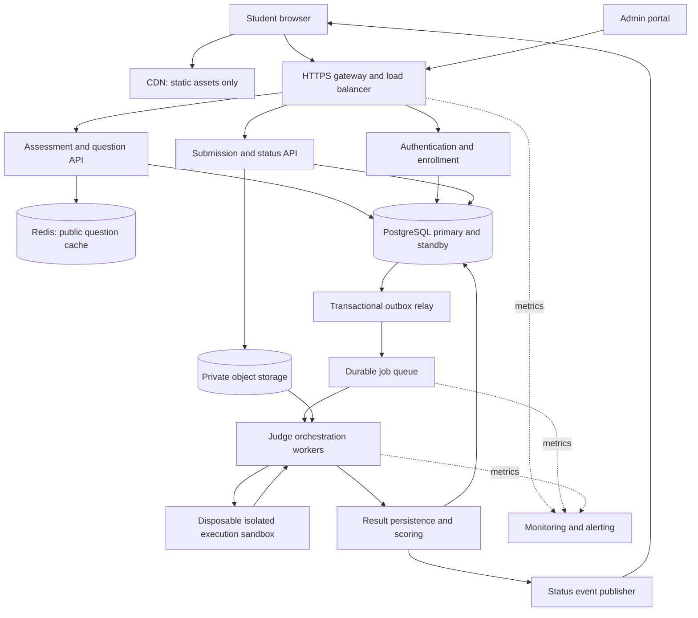

# Scalable coding assessment platform

## 1. Scope and assumptions

Students authenticate, join an assigned timed assessment, view public problem statements and samples, submit Python/Java/C++ code, and see verdicts and scores. Administrators create assessments, version questions and tests, enroll students and export results. The design supports submission history and a final leaderboard. A runnable application, live proctoring, payments and plagiarism verdict automation are outside this HLD deliverable.

Assume 10,000 concurrent students, four questions, five submissions per question and a two-hour exam. Exam start/end and submission-receipt time are enforced by server time. One student has one enrollment per assessment. A completed assessment is graded using a documented best-per-question policy. Code, tests and compiler images are versioned so a rejudge can reproduce an old result.

## 2. Quality targets

Targets to validate by load and failure testing, not measured results:

| Concern | Target / decision |
| --- | --- |
| Question reads | p95 below 200 ms at normal load |
| Accepted submission response | p95 below 300 ms after durable commit |
| Evaluation | p95 within 15 seconds under the stated load model; queue wait included |
| Availability | 99.9% monthly service target; 43.2 minutes budget in a 30-day month |
| Durability | Never acknowledge an accepted submission before its metadata and durable code reference are committed |
| Fairness | Per-student rate limit and fair scheduling; identical language resource policies for a given question |
| Isolation | Student processes have no network, cloud credentials, host mounts or shared writable state |

For an acknowledged local-AZ failure, target no committed data loss using synchronous replication within the region. Regional disaster recovery is a separate target: RPO at most five minutes and RTO at most 30 minutes, subject to backup/restore drills. These are different failure scopes, not a universal zero-loss claim.

## 3. Capacity estimates

- Submissions: 10,000 × 4 × 5 = 200,000 per exam.
- Average intake: 200,000 / 7,200 ≈ 27.8 submissions/second.
- Assume a five-times burst: about 140 submissions/second.
- At two CPU-seconds per submission on average, execution demand is 280 busy core-equivalents. At 70% planned utilization, budget roughly 400 single-core execution slots. At 256 MiB per slot, the slot memory budget alone is about 100 GiB, before OS/compiler overhead. Java or more expensive tests need larger limits and a recalculated budget.
- A five-second mean would require about 1,000 slots at the same utilization. Measure actual time and language mix before purchasing capacity.
- Questions/dashboard reads every ten seconds produce about 1,000 requests/second. If all 10,000 students also poll active submissions every two seconds, status reads add up to 5,000 requests/second. Adaptive polling and server-sent events can reduce this; capacity planning must not ignore it.
- At 5 KB of source per submission, source storage is about 1 GB per exam before replicas. At an estimated 1 KB metadata row, submission metadata is about 200 MB before indexes/WAL. Results/test-level metadata can add substantially more.
- A one-minute interruption at 140 submissions/second creates 8,400 queued jobs. At 200 completions/second while intake remains 140, draining takes about 140 seconds. Queue capacity and exam policy must accommodate bursts, not just average throughput.

## 4. Component diagram

Arrows show logical data flow, not unrestricted network access. Only the judge control process reads private test objects; it passes input to an isolated sandbox. The sandbox cannot call the judge, database or object store over the network. The CDN caches static assets, never authenticated results or hidden tests.

## 5. Service responsibilities and deployment choice

Start with a modular API application for authentication/enrollment, assessment/question management, submission intake and result reads. Deploy workers separately because their resource needs and trust boundary differ. Logical modules in the diagram do not require separate microservices from day one.

The gateway terminates TLS, applies coarse request-size/rate limits, forwards identity context and routes API calls. Services independently authorize every resource access. The assessment module owns schedules and immutable published question versions. Submission intake validates enrollment, deadlines, supported language, code size and idempotency. Workers supervise execution, capture bounded output and classify failures. Scoring persists results and computes the best current graded score per student/question; it never trusts a score supplied by the sandbox or client.

## 6. Data model and storage choices

| Relation | Key fields and constraints |
| --- | --- |
| Users | user_id PK, email UNIQUE, password_hash, role, created_at |
| Assessments | assessment_id PK, start_at, end_at, duration, owner_id FK, state |
| Enrollments | (assessment_id, user_id) PK, joined_at nullable until first join, personal_deadline nullable |
| Questions | (question_id, version) PK, assessment_id FK, prompt, points, language_limits |
| TestCases | test_id PK, question_id/version FK, private input/expected-output object keys, visibility, weight |
| Submissions | submission_id PK, user_id/assessment/question FKs, question_version (composite FK to Questions), desired_judge_version, language, code_key, received_at, state, attempt_version, lease_expires_at nullable |
| Idempotency | UNIQUE(user_id, assessment_id, key), request_digest, submission_id FK, expires_at |
| Outbox | event_id PK, submission_id, event_type, judge_version, created_at, published_at nullable |
| Results | UNIQUE(submission_id, judge_version), verdict, score, counts, runtime, memory |
| StagedCode | code_key PK, state (STAGING / REFERENCED / DELETING), lease_expires_at |
| Admission | assessment_id PK, outstanding_jobs, capacity; conditional atomic reservation |
| AuditEvents | actor, action, resource, timestamp, trace_id; restricted retention |

PostgreSQL provides transactions and constraints for submissions, outbox events and score updates. Private object storage holds immutable code and test files; metadata references object versions. Keep raw student code out of logs. Serve private objects only through authorized internal access, not public URLs. Index submission history by `(user_id, assessment_id, received_at)` and worker recovery by `(state, lease_expires_at)`; use a read replica for finalized reports, not read-after-write status that requires current state.

## 7. Submission acceptance and transactional outbox

1. Capture trusted `received_at` when the complete bounded request reaches intake. Authenticate and authorize the student/assessment and validate format/code size (at most 64 KiB). Never trust a client timestamp.
2. Resolve the student-scoped idempotency key before new-submission admission checks. Compare canonical request digests: identical bodies return the original receipt even after the deadline; different bodies return 409. New keys require enrollment with first join completed, supported language, the published question/version pair, and `start_at <= received_at <= personal_deadline`.
3. Create a committed STAGING row with a unique code object key and renewable upload lease before uploading to private storage. Store source durably. If upload fails, do not claim acceptance. The acceptance transaction must lock this staging row and require STAGING with a valid lease before proceeding; an expired/deleting row cannot be committed as accepted.
4. In one PostgreSQL transaction resolve/claim the unique idempotency key, compare its digest again if another request won, and return 409 on mismatch. For a new acceptance, revalidate enrollment/manifest and the same trusted `received_at` against the deadline, atomically reserve one admission slot with a conditional counter update (`outstanding_jobs < capacity`), create submission/mapping/outbox, and mark the locked staged object REFERENCED. An identical replay consumes no new capacity. Rollback reverses reservation on failure. A lock/statement timeout bounds the transaction; timeout means retry the same key, not manufacture a receipt.
5. Return 202 only after commit. Cleanup locks expired STAGING rows and atomically changes them to DELETING before deleting objects, using the same row lock as acceptance. It skips REFERENCED rows and cannot delete an in-flight locked object. If cleanup wins, acceptance must fail/restart; if acceptance wins, cleanup sees REFERENCED. A grace period alone is not a correctness mechanism. Retry deletion of DELETING objects; never reuse their keys.
6. The relay publishes committed outbox events with durable publisher confirmation before marking publication. Use a partial index on `(created_at, event_id) WHERE published_at IS NULL` and small `FOR UPDATE SKIP LOCKED` batches. Retain published events for seven days for diagnosis, then archive/delete in bounded batches; never age-delete unpublished events. Duplicate delivery is expected.

Do not independently write a database row and enqueue a job without an outbox: either side can succeed alone. When the database is unavailable, return 503 and preserve the student's local draft. Queue buffering alone is not acceptance when the authoritative record was not committed.

## 8. Execution, verdicts and scoring

Workers claim jobs only when the message judge version equals the submission’s `desired_judge_version`, with a renewable lease and an incrementing attempt/fencing token. Stale judge-version jobs are acknowledged without execution. Download the versioned source/tests into the trusted worker control area, create a sandbox with pinned toolchain, compile with a compilation timeout, then run each test with CPU, wall-clock, memory, process and output limits. Limit aggregate job time as well as per-test time. Distinguish compilation errors, wrong answers, timeouts, memory limits and infrastructure failures.

Use immutable expected outputs and a versioned checker policy (for example normalized trailing whitespace only when explicitly specified). Compute weighted scores in the trusted judge process. Persist the terminal result transactionally with conditions on both the current fencing token and desired judge version, then acknowledge the queue message. A superseded worker must not overwrite a newer attempt's result. Only results matching the desired judge version contribute to status and scoring; older versions remain audit history. Rejudge atomically increments desired judge version and fencing token, clears the old lease, sets QUEUED and writes an outbox event. If replacing a pending job, reuse its capacity reservation; if the submission was terminal, reserve a new slot atomically or reject before changing state. Transition to a terminal state releases that reservation exactly once. Repeated rejudge requests are idempotent. Scores are recomputed from current completed results once each; pending rejudges cannot silently use old grades. Published leaderboard snapshots are invalidated until the owner releases a finalized replacement. See the API contract for publication and snapshot pagination.

## 9. Sandbox boundary

Ordinary containers alone are not a sufficient trust boundary for arbitrary student code. Prefer microVMs or a hardened userspace-kernel sandbox combined with host isolation. Use an unprivileged UID, dropped capabilities, seccomp policy, no privileged devices, no Docker socket, no host mounts, network disabled and cloud metadata access blocked at the host boundary too.

The root filesystem is read-only. Provide a small, isolated writable temporary filesystem for compilation and runtime files; delete it after every submission. Bound file size, file descriptors, process count, stdout/stderr and wall-clock duration. The trusted controller streams only the required input to the child process. Expected outputs, credentials and other students' files are never present in the sandbox. A program can read its provided test input; protection means preventing that input from being exfiltrated to the student through result APIs, logs or network.

Pre-warm clean base images/runtime capacity, not writable state from previous submissions. Destroy the per-submission instance after use. Patch toolchains and sandbox images, and use dedicated worker hosts separate from the API/database tier.

## 10. Queue, retries and backpressure

A durable queue decouples quick intake from expensive execution. Use per-language pools and fair scheduling by assessment/student to avoid one user consuming the whole pool. Autoscale using estimated work backlog, queue age and available memory; a fixed queue-length threshold ignores job duration.

Worker infrastructure failures retry with exponential backoff and jitter, up to three attempts. Wrong answer, compilation error and user time-limit errors are final verdicts, not infrastructure retries. Repeated infrastructure failures move to a dead-letter queue, set an explicit system-error status and alert operators. Provide a controlled replay/rejudge action with audit logs. Duplicate messages after completion simply acknowledge the existing result.

If backlog threatens the exam SLA, show queue state and apply admission limits before acceptance. A 429/503 means the submission was not accepted; an acknowledged 202 remains a durable responsibility. Record original receive time so a job accepted before the deadline can finish after it without unfair rejection.

## 11. Caching and status delivery

Cache public prompts/samples by immutable assessment/question version; publish invalidation on new versions. Never place hidden test content in the client-facing cache. Redis stores rate-limit counters and optional short-lived submission status summaries. Database results remain authoritative and survive cache loss.

After submission, poll with backoff (for example two, four, eight seconds) or use authenticated server-sent events. SSE events carry only status identifiers; a reconnect resumes from the last event or fetches authoritative status. All result reads verify ownership or administrator permissions, preventing access by guessing submission IDs. Use primary reads or a bounded consistency mechanism immediately after acceptance.

## 12. Idempotency and rate limits

Scope opaque client-generated idempotency keys to the student and assessment. Retain mappings for the assessment record lifetime, at least 90 days after end, covering the full advertised reconciliation window. Return `receipt_expires_at` to clients. After archival the assessment stays closed and rejects new attempts, preventing an expired key from creating a duplicate; unresolved cases after the advertised window require administrator reconciliation. Bind each to a canonical request digest. Do not use code hash alone as the key: identical code can be an intentional later submission.

Example limits are one submission per student per ten seconds and an assessment-wide intake cap based on available capacity, enforced by a conditional database counter reservation in the acceptance transaction. Redis rate limits are additional throttling, not the authoritative capacity bound. Return `Retry-After` on 429. Apply separate read/poll limits, use bounded request bodies and preserve trusted identity across the gateway. If the distributed rate-limit store fails, use a conservative per-instance fallback and alert; do not silently remove all protection.

## 13. Availability and failure recovery

Run API instances, queue replicas and database replicas across availability zones. Use database failover with fencing to avoid two writable primaries. Connection pools, deadlines and circuit breakers stop cascading failures. Back up PostgreSQL with point-in-time recovery and enable object versioning with scoped retention.

| Failure | Recovery / user-visible behavior |
| --- | --- |
| API dies after database commit | Retry idempotency key returns same submission |
| Relay dies before recording publish | Event may repeat; consumer/result writes are idempotent |
| Worker dies while judging | Lease expires; job retries with new fencing token |
| Old worker returns late | Result write rejected by attempt-version check |
| Queue unavailable | Outbox retains accepted jobs; stop intake before backlog exceeds safe limits |
| Database unavailable | Do not acknowledge new submissions; preserve browser draft, return retryable 503 |
| Object storage unavailable | Fail new acceptance or retry worker fetch; never substitute missing tests |
| Cache unavailable | Controlled database fallback with rate limits |
| Browser disconnects | Restore local draft and submission IDs; retrieve status after login |
| Region lost | Restore from tested backups under explicit regional RPO/RTO |

## 14. Security, privacy and integrity

Hash passwords with a suitable password hashing scheme; use short-lived signed access tokens, strict issuer/audience/expiry checks and revocable sessions. Tenant/assessment authorization is checked in the application for every read and write. Admin MFA and role separation protect test publishing and rejudge operations. Encrypt transport and storage; rotate credentials through a secret manager. Parameterize SQL and validate uploads.

Do not return hidden test input, expected output, or student's captured output for hidden cases. Return verdict and aggregate counts; per-case timing can also leak information, so constrain it. Protect admin exports with authorization and expiring download access. Retain submissions for an institution-agreed period; use pseudonymous IDs for analytics and avoid unnecessary personal data.

Plagiarism analysis runs asynchronously after the assessment using tokenized code fingerprints and similarity clusters. Similarity is only a signal for human review: templates and standard algorithms can resemble each other. Never automatically fail a student on a similarity threshold alone. Audit any grading changes.

## 15. Observability and validation

Collect request latency/error rate, accepted-vs-completed submission counts, oldest outbox event age, oldest queue job age, execution time by language, timeout rates, retry/DLQ counts, sandbox creation failures, DB replication lag and resource utilization. Correlate via submission/trace IDs without logging code or hidden tests. Alert on stale accepted jobs, sustained error-budget burn, outbox growth, DLQ growth and loss of worker capacity.

Validation plan: simulate the 140/second burst and 6,000/second combined read/poll case; test idempotency races, duplicate queue delivery, worker/relay crashes and DB failover; attempt network/file access and fork/output bombs in the sandbox; verify ownership checks, deadlines and hidden-test redaction; restore backups and compare committed submission counts. No such infrastructure load test is claimed to have run for this design-only submission.

## 16. Tradeoffs and evolution

A modular API with PostgreSQL reduces operational complexity; workers remain independently scalable. The outbox adds a relay and possible delivery lag but removes a dangerous dual-write gap. A dedicated execution sandbox costs startup/compute time in exchange for a stronger isolation boundary. SSE reduces polling but introduces persistent connection management. Strict deadline enforcement improves fairness but needs clear outage policy from the institution. Partition historical submissions and split services only when measured bottlenecks justify the added complexity.

## 16. Enrollment and immutable assessment versions

Admin provisioning grants eligibility without starting a student’s timer. First student join fixes `joined_at` and `personal_deadline = min(max(joined_at, start_at) + duration, end_at)`; repeated joins cannot extend it. A join needs authentication/eligibility/passkey, not pre-existing enrollment. Creating an assessment needs an admin role; ownership applies after creation. Published assessments have a frozen question/version manifest, backed by the composite Questions key and matching TestCases and Submissions foreign keys. New content requires a new assessment. This keeps displayed prompts and submitted code tied to the same tests. Student leaderboard access is limited to released final snapshots and assessment-scoped aliases.
